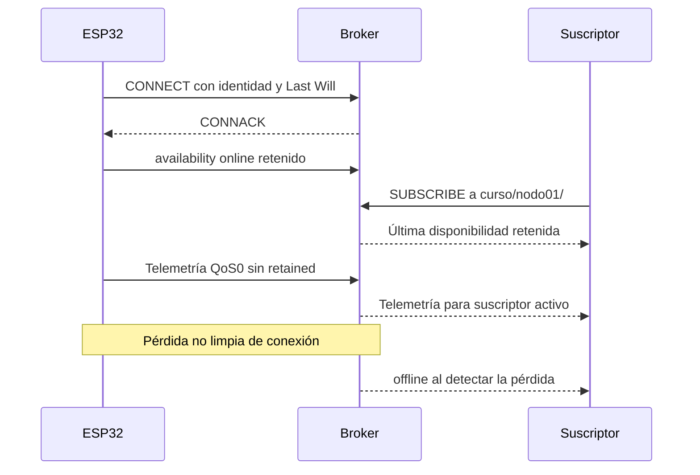
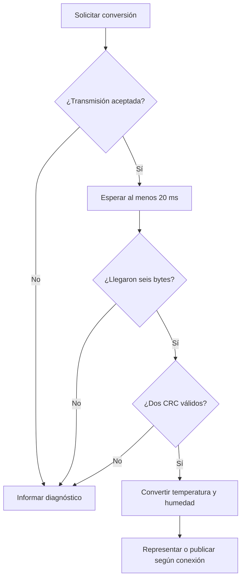
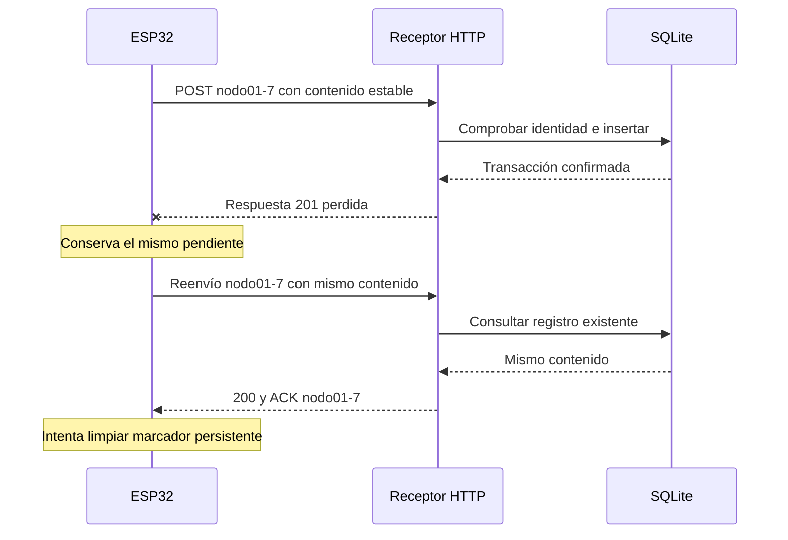
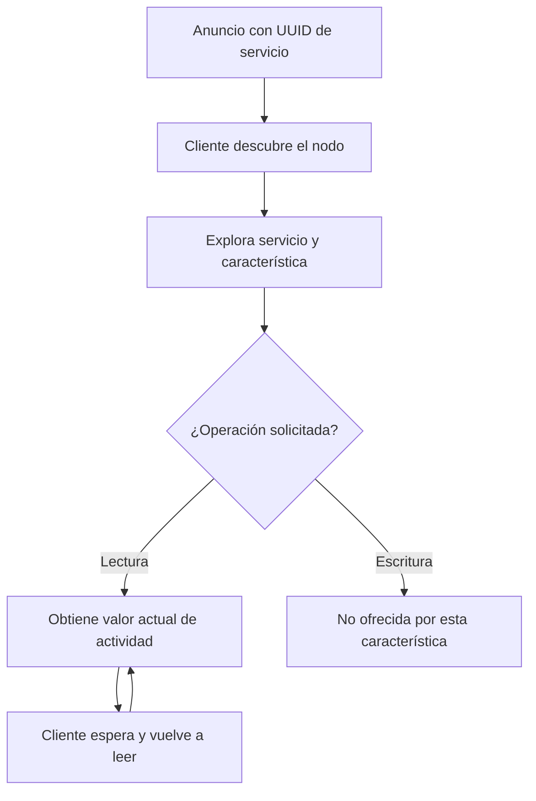
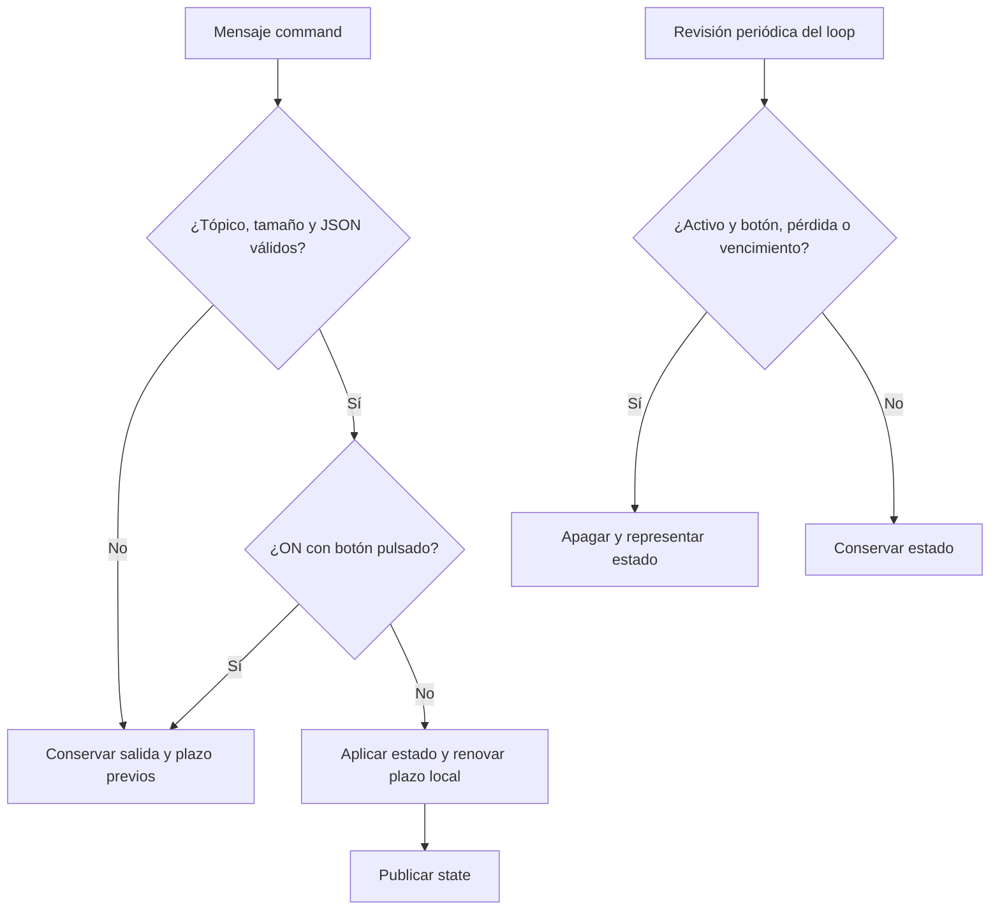

# Recorridos de protocolos y estados

[Curso](../README.md) · [Soporte de red](LECTURA_RED_MQTT.md) · [Conexiones físicas](ATLAS_CONEXIONES.md)

Cada diagrama muestra responsabilidades que deben comprobarse por separado. Los tiempos nominales describen decisiones del programa, no medidas realizadas con una placa.

## MQTT: publicación, suscripción y disponibilidad

La publicación de telemetría no lleva confirmación de almacenamiento de aplicación. Un nuevo suscriptor no recibe un histórico de telemetría de este ejemplo. Revisa la Unidad 10 antes de atribuir a retained o QoS una propiedad diferente.

## SHT31: aceptar antes de representar

CRC y longitud controlan integridad de la respuesta. No certifican calibración ni la salud completa del módulo. Las llamadas del bus tienen costos y límites propios.

## Reenvío HTTP: respuesta perdida después de guardar

El mensaje local Confirmado informa ACK remoto. La limpieza del marcador también puede fallar. Un contenido distinto con la misma identidad recibe 409 en vez de sobrescribir. La creación de las claves NVS del dispositivo no es una transacción atómica de aplicación.

## BLE: descubrir, leer y volver a leer

La característica solo READ no envía notificaciones al actualizar setValue. Ver un anuncio no autentica al emisor ni demuestra lectura de una característica.

## Backoff: tiempo de espera tras fallos

| Intento simulado | Intervalo nominal | Tiempo acumulado nominal |
|---:|---:|---:|
| 1 | 1 s | 1 s |
| 2 | 2 s | 3 s |
| 3 | 4 s | 7 s |
| 4 | 8 s | 15 s |
| 5 | 16 s | 31 s |
| 6 | 16 s | 47 s |

La referencia no incluye jitter ni conexión real. Un máximo de intervalo no limita el número total de intentos. `r` reinicia la política y la deshabilita; `f` habilita tomando una marca nueva, sin reiniciar por sí sola el contador ni el intervalo escalado.

## Control local y remoto: condiciones antes de actuar

El diagrama de botón corresponde a unidades 22 y 23; la Unidad 11 no lo incorpora. Una llamada de red puede retrasar atención. No hay comprobación de antigüedad de una orden, realimentación de una carga ni una cota de tiempo certificada.
