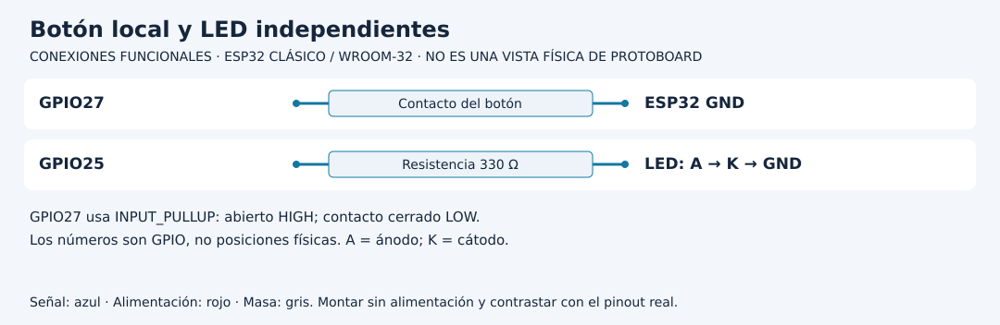

# Relacionar GPIO, nivel eléctrico y significado

[Unidad](README.md) · [Laboratorio](LABORATORIO.md) · [Soluciones](SOLUCIONES.md)

**Programas de referencia:** [pines](ejemplos/pines/pines.ino). Abre el código completo mientras sigues el recorrido.

## Esquema de conexiones

Los diagramas identifican señales, no posiciones físicas. Usa la referencia clásica y confirma el pinout de tu tarjeta y módulo. [Atlas completo](../docs/ATLAS_CONEXIONES.md).

## 1. Traslada el concepto, comprueba el terminal

La práctica usa LED externo en GPIO25 con 330 Ω y cátodo a GND; botón entre GPIO27 y GND. Los números son GPIO, no posiciones contadas desde una esquina. Trabaja con la referencia clásica del entorno, a lógica de 3.3 V.

En Uno podías usar algunos terminales como entrada o salida. En ESP32 clásico GPIO34 es solo entrada y carece de pull-up interno. Declararlo OUTPUT no crea un controlador de salida. También hay terminales con funciones de arranque o reservados por el módulo; evita elegirlos por proximidad física.

## 2. Sigue la polarización del botón

`INPUT_PULLUP` mantiene HIGH cuando el contacto está abierto. Al pulsar se conecta a GND y se observa LOW. La expresión `digitalRead(BOTON) == LOW` traduce un nivel eléctrico a la variable de significado `pulsado`.

| Contacto | Lectura | pulsado | LED solicitado |
|---|---|---|---|
| Abierto | HIGH | false | OFF |
| Cerrado | LOW | true | ON |

Escribir `pulsado` en el LED funciona porque el montaje del LED se activa con HIGH. Un LED cableado para activación en LOW necesitaría otra traducción; la variable de significado podría conservarse.

## 3. Comprende el muestreo lento

La referencia espera 250 ms después de mostrar el estado. Puede pasar por alto una pulsación más corta ocurrida entre lecturas. No es una prueba de que el botón falle. Tampoco estabiliza formalmente el rebote: simplemente observa a un ritmo bajo.

Mantener pulsado produce mensajes repetidos porque se informa un nivel, no un evento único. Más adelante se estudiarán interrupciones y decisiones de control distintas. No atribuyas a esta práctica un contador de pulsaciones.

## 4. Cambia la interpretación antes del hardware

En una copia invierte la comparación para considerar HIGH como pulsado. Predice que el LED quedará encendido al soltar y apagado al cerrar. El circuito no cambió; cambió su interpretación. Restaura LOW.

Para adaptar otra placa, sustituye primero el efecto del LED por un mensaje. Después identifica un GPIO de salida válido en su pinout y añade la rama con resistencia. Así separas comprensión de la regla de compatibilidad eléctrica.

[Realizar el laboratorio](LABORATORIO.md) · [Contrastar las soluciones](SOLUCIONES.md) · [Volver a la unidad](README.md)

---

### ¿Necesitas apoyo con este tema?

Si te bloqueaste con la práctica, necesitas revisar tu entorno o adaptar lo aprendido a tu proyecto, podemos trabajarlo en una sesión personalizada.

[**Solicitar asesoría para este tema por WhatsApp**](https://wa.me/573103618296?text=Hola%2C%20Leli.%20Estoy%20estudiando%20Unidad%2001%20%E2%80%94%20Arquitectura%2C%20GPIO%20y%20diferencias%20con%20Arduino%20del%20curso%20ESP32%20e%20Internet%20de%20las%20Cosas%20%28https%3A%2F%2Fgithub.com%2Flelyliliana%2FCurso-ESP32%2Ftree%2Fmain%2Funidad01-arquitectura-gpio%29%20y%20necesito%20una%20asesor%C3%ADa%20personalizada.%20Mi%20duda%20es%E2%80%A6)
