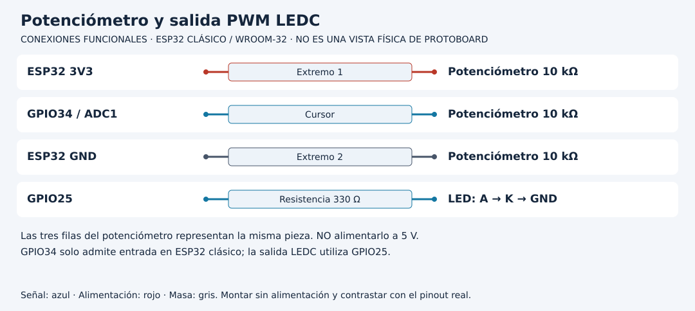

# Pasar de una lectura ADC a una salida LEDC

[Unidad](README.md) · [Laboratorio](LABORATORIO.md) · [Soluciones](SOLUCIONES.md)

**Programas de referencia:** [adc_pwm](ejemplos/adc_pwm/adc_pwm.ino). Abre el código completo mientras sigues el recorrido.

## Esquema de conexiones

Los diagramas identifican señales, no posiciones físicas. Usa la referencia clásica y confirma el pinout de tu tarjeta y módulo. [Atlas completo](../docs/ATLAS_CONEXIONES.md).

## 1. Dos circuitos y una decisión

El potenciómetro de 10 kΩ se conecta entre 3V3 y GND con cursor a GPIO34. El LED va de GPIO25 por 330 Ω hacia ánodo y cátodo a GND. No alimentes el divisor desde 5 V: su cursor llega directamente al ADC.

GPIO34 pertenece a ADC1 en la referencia clásica, una elección útil al integrar Wi-Fi. La atenuación configurada modifica el rango medible; no convierte el terminal en tolerante a tensiones arbitrarias ni hace lineal toda la respuesta.

## 2. Identifica las escalas

`analogReadResolution(12)` fija 12 bits: códigos 0..4095. `ledcAttach(LED, 5000, 8)` solicita PWM a 5000 Hz con 8 bits de resolución, por tanto comandos 0..255. Son tres conceptos diferentes: resolución de lectura, frecuencia de salida y resolución del comando.

| Lectura ADC | Cálculo entero | duty |
|---:|---|---:|
| 0 | 0 × 255 / 4095 | 0 |
| 2048 | 2048 × 255 / 4095 | 127 |
| 4095 | 4095 × 255 / 4095 | 255 |

El sufijo UL mantiene el producto en aritmética entera sin signo adecuada. La división trunca. El punto central no se redondea automáticamente a 128.

## 3. Configuración que puede fallar

Si ledcAttach devuelve false, la referencia informa fallo y detiene el avance normal. No continúa como si hubiera creado la señal. En core 3.x, ledcWrite recibe el pin en este uso; trasladar sin revisión un ejemplo 2.x basado en canales puede cambiar el significado.

Cada 200 ms se adquiere una muestra, se convierte y se actualiza el duty. Esos 200 ms son el ritmo del control, no el periodo de los pulsos de 5000 Hz generados por LEDC.

## 4. Limita con una intención clara

Para imponer un máximo de 128, recorta duty solo si supera ese límite antes de escribirlo. Eso satura la parte superior. Reescalar todo el potenciómetro a 0..128 sería otra decisión y daría aproximadamente 64 en el centro. Predice cuál comportamiento deseas.

## 5. Un ADC no es automáticamente un voltímetro

La expresión raw/4095×3.3 normaliza extremos ideales, pero ignora calibración, atenuación, saturación y respuesta del dispositivo. La API analogReadMilliVolts ofrece una conversión calibrada soportada por el entorno; tampoco garantiza toda la precisión de un montaje. Conserva unidad y método en tu registro. Un dato ADC de fondo de escala puede significar saturación, no exactamente 3.300 V.

[Realizar el laboratorio](LABORATORIO.md) · [Contrastar las soluciones](SOLUCIONES.md) · [Volver a la unidad](README.md)

---

### ¿Necesitas apoyo con este tema?

Si te bloqueaste con la práctica, necesitas revisar tu entorno o adaptar lo aprendido a tu proyecto, podemos trabajarlo en una sesión personalizada.

[**Solicitar asesoría para este tema por WhatsApp**](https://wa.me/573103618296?text=Hola%2C%20Leli.%20Estoy%20estudiando%20Unidad%2003%20%E2%80%94%20Entradas%2C%20salidas%2C%20ADC%20y%20PWM%20del%20curso%20ESP32%20e%20Internet%20de%20las%20Cosas%20%28https%3A%2F%2Fgithub.com%2Flelyliliana%2FCurso-ESP32%2Ftree%2Fmain%2Funidad03-io-adc-pwm%29%20y%20necesito%20una%20asesor%C3%ADa%20personalizada.%20Mi%20duda%20es%E2%80%A6)
