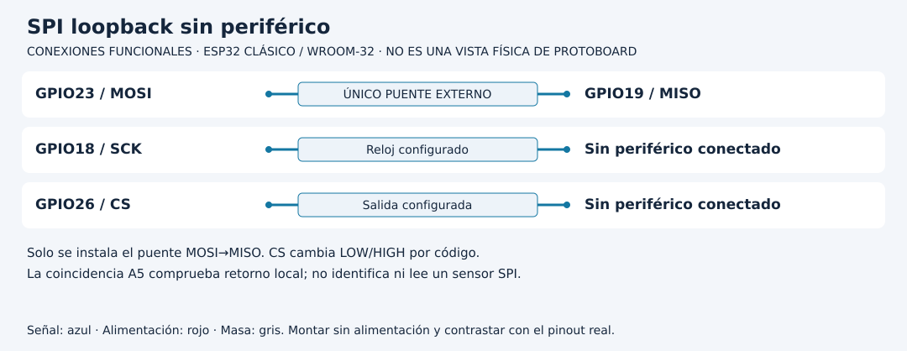

# Leer un SHT31 completo y separar el ensayo SPI

[Unidad](README.md) · [Laboratorio](LABORATORIO.md) · [Soluciones](SOLUCIONES.md)

**Programas de referencia:** [i2c_sht31](ejemplos/i2c_sht31/i2c_sht31.ino) · [spi_loopback](ejemplos/spi_loopback/spi_loopback.ino). Abre el código completo mientras sigues el recorrido.

## Esquema de conexiones

Los diagramas identifican señales, no posiciones físicas. Usa la referencia clásica y confirma el pinout de tu tarjeta y módulo. [Atlas completo](../docs/ATLAS_CONEXIONES.md).

## 1. Comprobar dirección no equivale a medir

La práctica I2C usa SHT31 compatible con 3.3 V, SDA21, SCL22 y dirección 0x44. El escaneo de setup identifica respuestas ACK. No prueba todavía identidad exacta, conversión ni integridad del dato. Consulta la dirección configurada por ADDR en tu módulo antes de cambiar la constante a 0x45.

## 2. Sigue las dos fases de adquisición

Cada dos segundos, si no está esperando, el programa envía bytes 0x24 y 0x00 al sensor. Si la transmisión falla anuncia ausente y no inicia una lectura. Cuando tiene éxito conserva inicio y activa esperando.

Después de al menos 20 ms solicita seis bytes. La espera entre fases permite recorrer loop; las operaciones Wire siguen teniendo costos y límites propios. `Wire.setTimeOut(50)` no convierte el bus en una operación sin espera.

| Posiciones de respuesta | Contenido |
|---|---|
| 0 y 1 | Palabra de temperatura |
| 2 | CRC de esa palabra |
| 3 y 4 | Palabra de humedad |
| 5 | CRC de esa palabra |

Si llegan menos de seis, no utiliza una respuesta parcial. Después comprueba dos CRC con inicial 0xFF y polinomio 0x31. CRC detecta ciertos errores de datos; no autentica quién envió el mensaje ni calibra el sensor.

## 3. Del orden de bytes a unidades

`(b[0] << 8) | b[1]` reúne byte alto y bajo en una palabra. Para un valor digital S, temperatura es `-45 + 175 × S / 65535`; humedad es `100 × S / 65535`. Una división hecha antes de convertir a flotante podría perder fracciones. El programa convierte explícitamente.

No llames válido a cualquier dato solo porque el escaneo encontró 0x44. Hay tres comprobaciones diferentes: respuesta a dirección, longitud e integridad.

## 4. El ensayo SPI es otra práctica

Desenergiza y retira I2C antes de montarlo. El retorno local conecta MOSI23 con MISO19. El código define SCK18 y CS26, solicita modo 0 a 100 kHz y compara el byte recibido con A5. Sin periférico, no se conecta CS o SCK a un sensor: no hay registros que leer.

Un A5 devuelto demuestra un recorrido local bajo esas condiciones. Pasar a un sensor SPI exige su protocolo, selección, niveles, modo y comandos. No transfieras la fórmula SHT31 al byte devuelto por un puente.

[Realizar el laboratorio](LABORATORIO.md) · [Contrastar las soluciones](SOLUCIONES.md) · [Volver a la unidad](README.md)

---

### ¿Necesitas apoyo con este tema?

Si te bloqueaste con la práctica, necesitas revisar tu entorno o adaptar lo aprendido a tu proyecto, podemos trabajarlo en una sesión personalizada.

[**Solicitar asesoría para este tema por WhatsApp**](https://wa.me/573103618296?text=Hola%2C%20Leli.%20Estoy%20estudiando%20Unidad%2004%20%E2%80%94%20Sensores%2C%20I2C%20y%20SPI%20del%20curso%20ESP32%20e%20Internet%20de%20las%20Cosas%20%28https%3A%2F%2Fgithub.com%2Flelyliliana%2FCurso-ESP32%2Ftree%2Fmain%2Funidad04-sensores-buses%29%20y%20necesito%20una%20asesor%C3%ADa%20personalizada.%20Mi%20duda%20es%E2%80%A6)
