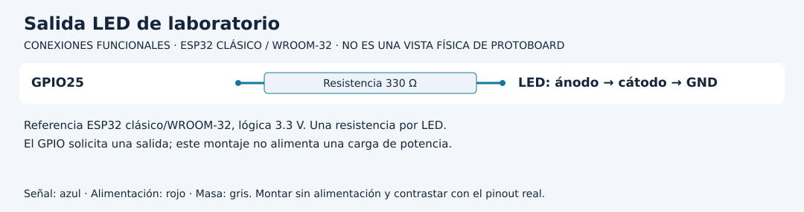

# Separar orden, estado y vencimiento en MQTT

[Unidad](README.md) · [Laboratorio](LABORATORIO.md) · [Soluciones](SOLUCIONES.md)

**Programas de referencia:** [mqtt_control](ejemplos/mqtt_control/mqtt_control.ino). Abre el código completo mientras sigues el recorrido.

**Apoyo para este recorrido:** [protocolos y estados](../docs/RECORRIDOS_PROTOCOLOS.md) · [lectura del soporte de red/MQTT](../docs/LECTURA_RED_MQTT.md).

## Esquema de conexiones

Los diagramas identifican señales, no posiciones físicas. Usa la referencia clásica y confirma el pinout de tu tarjeta y módulo. [Atlas completo](../docs/ATLAS_CONEXIONES.md).

## 1. Ordenar ON no es alternar

El callback recibe tópico, bytes y longitud. Primero comprueba que el destino sea command y que no supere 128 bytes. Después deserializa usando la longitud explícita; el payload no tiene por qué terminar con un cero de cadena C.

Acepta exactamente un campo activo de tipo booleano. Si el contrato falla no cambia salida ni renueva la marca del último comando. Un texto que dice true no es el booleano true.

## 2. Tres acciones después de aceptar

Asigna activo, guarda millis en ultimoComando y escribe GPIO25. Después publica ON/OFF en state con retained. El estado reportado es una decisión de firmware, no una medición independiente del LED.

| Suceso | Estado | Marca de supervisión |
|---|---|---|
| true válido | ON | Se renueva |
| true válido de nuevo | Continúa ON | Se vuelve a renovar |
| false válido | OFF | Se renueva |
| Mensaje inválido | Conserva previo | No se renueva |
| Plazo vencido o enlace perdido detectado | OFF | No se crea orden nueva |

La repetición es idempotente respecto al estado de salida, pero **renueva el plazo**. No es idéntica en todos sus efectos temporales.

## 3. Vencimiento local

El loop apaga si activo y han pasado diez segundos desde el último comando aceptado, o si detecta pérdida de Wi-Fi/MQTT. El plazo comienza al recibir, no a la hora en que una persona creó el mensaje. La referencia no transporta expires_at ni command_id.

Al establecer una sesión nueva vuelve a suscribirse y publica estado. La suscripción actual usa QoS0. No se configura una sesión persistente que guarde automáticamente comandos mientras la placa estuvo apagada.

## 4. Por qué no retener órdenes

Una orden ON retained puede ser entregada al volver a suscribirse. El firmware no incorpora fecha o identidad que permita reconocerla como antigua; podría aceptarla como una instrucción recibida ahora. El plazo de diez segundos no resuelve esa antigüedad porque empezaría otra vez al recibir.

En los ensayos publica command sin retained. Documenta si el broker ya tenía una orden retenida de otro intento y límpiala antes del recorrido según su administración autorizada. No declares que el callback detecta retained: su firma aquí no expone esa decisión.

## 5. Traza una renovación

Envía true en t=0 y otra vez en t=6 s. Si no llega nada más, el apagado por plazo se espera alrededor de t=16 s, sujeto a atención del loop. Un fallo de red puede apagar antes cuando se detecte. Registra causa y tiempo observado, no solo el texto final OFF.

[Realizar el laboratorio](LABORATORIO.md) · [Contrastar las soluciones](SOLUCIONES.md) · [Volver a la unidad](README.md)

---

### ¿Necesitas apoyo con este tema?

Si te bloqueaste con la práctica, necesitas revisar tu entorno o adaptar lo aprendido a tu proyecto, podemos trabajarlo en una sesión personalizada.

[**Solicitar asesoría para este tema por WhatsApp**](https://wa.me/573103618296?text=Hola%2C%20Leli.%20Estoy%20estudiando%20Unidad%2011%20%E2%80%94%20Telemetr%C3%ADa%20y%20control%20con%20MQTT%20del%20curso%20ESP32%20e%20Internet%20de%20las%20Cosas%20%28https%3A%2F%2Fgithub.com%2Flelyliliana%2FCurso-ESP32%2Ftree%2Fmain%2Funidad11-telemetria-control%29%20y%20necesito%20una%20asesor%C3%ADa%20personalizada.%20Mi%20duda%20es%E2%80%A6)
