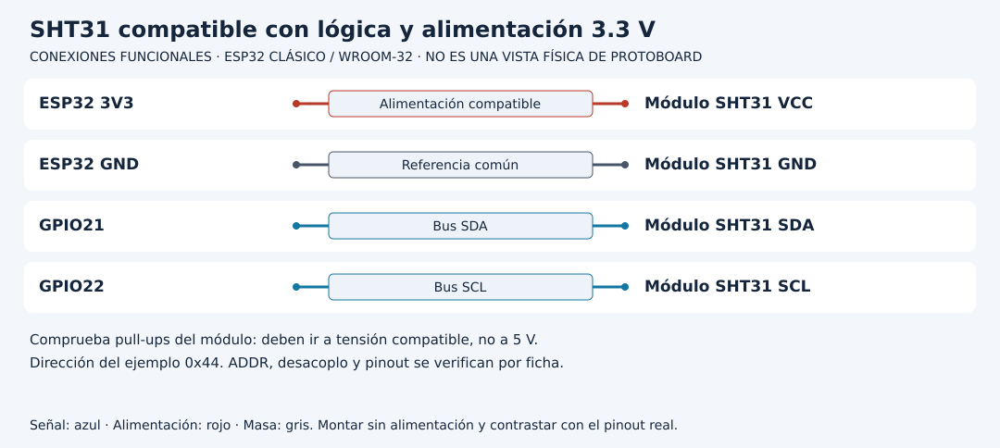

# Construir un nodo ambiental y localizar pérdidas

[Unidad](README.md) · [Laboratorio](LABORATORIO.md) · [Soluciones](SOLUCIONES.md)

**Programas de referencia:** [nodo_ambiental](ejemplos/nodo_ambiental/nodo_ambiental.ino). Abre el código completo mientras sigues el recorrido.

**Apoyo para este recorrido:** [protocolos y estados](../docs/RECORRIDOS_PROTOCOLOS.md) · [lectura del soporte de red/MQTT](../docs/LECTURA_RED_MQTT.md).

## Esquema de conexiones

Los diagramas identifican señales, no posiciones físicas. Usa la referencia clásica y confirma el pinout de tu tarjeta y módulo. [Atlas completo](../docs/ATLAS_CONEXIONES.md).

## 1. Integra adquisición y publicación por etapas

El nodo combina SHT31 a 3.3 V con SDA21/SCL22 y MQTT sobre la LAN. Primero comprueba el sensor con la Unidad 04 y el broker con la Unidad 10. Si cada parte falla de forma independiente, integrarlas no ayuda a localizar el problema.

La adquisición y MQTT se atienden en un mismo loop. Se solicita una conversión cada cinco segundos y se espera al menos veinte milisegundos antes de leer. Esa separación permite recorrer otras tareas entre fases; no elimina los posibles bloqueos de llamadas de red y bus.

## 2. Solo representa respuestas completas

Se envía el comando 0x24/0x00, se comprueba transmisión, se requieren seis bytes y se validan dos CRC. Si falla cualquiera, informa diagnóstico y no publica una medida sustitutiva. Temperatura y humedad provienen de la conversión SHT31, no del valor fijo del servidor HTTP de otro laboratorio.

| Campo | Significado en esta referencia |
|---|---|
| nodo | Etiqueta nodo01 |
| temperatura_c | Conversión en Celsius |
| humedad_pct | Conversión de humedad relativa |
| uptime_ms | Tiempo de actividad local observado |

uptime_ms no es una fecha UTC. Un reinicio puede hacerlo volver a valores bajos. Nodo es una etiqueta del mensaje, no una identidad autenticada de forma independiente por este firmware.

## 3. Recorre el trayecto completo

Wire recibe bytes; el programa valida y convierte; ArduinoJson serializa a un buffer de 256 bytes; el monitor muestra el documento y PubSubClient solicita publicación si está conectado. Un suscriptor debe estar activo para comprobar recepción.

La telemetría no es retained y se publica con QoS0. Si el broker no está conectado, solo se representa localmente y se anuncia que no se almacena. Si publish falla, no hay cola de reintento del dato en este nodo.

## 4. Qué demuestra observar el mensaje

Ver JSON en Serial prueba una etapa local. Ver el tópico en el suscriptor añade evidencia de transporte/distribución. Verlo guardado en una base exigiría un consumidor con almacenamiento y una comprobación distinta. La disponibilidad online retenida tampoco acredita que el sensor esté sano.

Detener Wi-Fi no conserva automáticamente las medidas. El soporte intenta recuperar red, pero no reconstruye muestras perdidas. Adquisición periódica y conservación de datos son requisitos separados.

## 5. Amplía el contrato con procedencia

Para añadir source=real y schema_version=1 modifica el documento y los consumidores que exigen un esquema cerrado. Comprueba tamaño serializado y buffer de transporte. La etiqueta real declara procedencia implementada; no certifica precisión ni calibración.

Antes de incorporar el pendiente de la Unidad 16, guarda también valor, unidades, calidad e identidad estables. Reenviar después una muestra nueva bajo la identidad de la anterior generaría un conflicto o rompería el significado del registro.

[Realizar el laboratorio](LABORATORIO.md) · [Contrastar las soluciones](SOLUCIONES.md) · [Volver a la unidad](README.md)

---

### ¿Necesitas apoyo con este tema?

Si te bloqueaste con la práctica, necesitas revisar tu entorno o adaptar lo aprendido a tu proyecto, podemos trabajarlo en una sesión personalizada.

[**Solicitar asesoría para este tema por WhatsApp**](https://wa.me/573103618296?text=Hola%2C%20Leli.%20Estoy%20estudiando%20Unidad%2021%20%E2%80%94%20Proyecto%3A%20nodo%20IoT%20ambiental%20del%20curso%20ESP32%20e%20Internet%20de%20las%20Cosas%20%28https%3A%2F%2Fgithub.com%2Flelyliliana%2FCurso-ESP32%2Ftree%2Fmain%2Funidad21-proyecto-nodo-iot%29%20y%20necesito%20una%20asesor%C3%ADa%20personalizada.%20Mi%20duda%20es%E2%80%A6)
