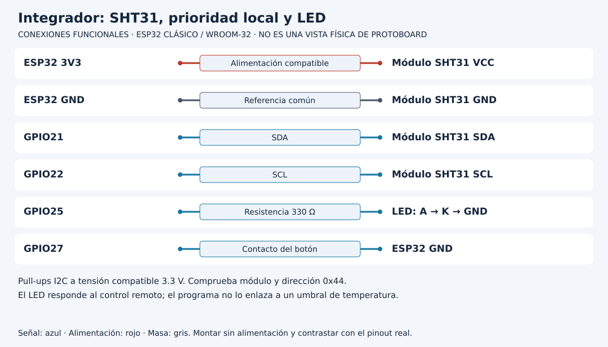

# Evaluar una integración por recorrido y por fallo

[Unidad](README.md) · [Laboratorio](LABORATORIO.md) · [Soluciones](SOLUCIONES.md)

**Programas de referencia:** [integrador](ejemplos/integrador/integrador.ino). Abre el código completo mientras sigues el recorrido.

**Apoyo para este recorrido:** [protocolos y estados](../docs/RECORRIDOS_PROTOCOLOS.md) · [lectura del soporte de red/MQTT](../docs/LECTURA_RED_MQTT.md).

## Esquema de conexiones

Los diagramas identifican señales, no posiciones físicas. Usa la referencia clásica y confirma el pinout de tu tarjeta y módulo. [Atlas completo](../docs/ATLAS_CONEXIONES.md).

## 1. Dos recorridos comparten dispositivo

El integrador reúne adquisición SHT31 y telemetría con control remoto de LED y prioridad de botón local. No conecta automáticamente temperatura alta con encender LED: el LED responde al comando aceptado. La temperatura se publica en un recorrido paralelo de la aplicación.

El mapa de pines no se superpone: SDA21, SCL22, LED25 y botón27 en ESP32 clásico. La referencia usa módulos compatibles 3.3 V y LED con resistencia. El proyecto libre puede ampliar hardware, pero debe rediseñar recursos y alimentación antes de trasladar un resultado.

## 2. Traza una lectura

Cada cinco segundos solicita medición, espera el plazo del sensor, exige longitud y CRC, convierte unidades y serializa. Representa por Serial y solicita publicación en telemetry si existe conexión MQTT. El broker distribuye a suscriptores interesados. No hay almacenamiento persistente local de esas muestras ni confirmación de base de datos.

| Evidencia | Qué permite afirmar |
|---|---|
| CRC y seis bytes aceptados | Respuesta coherente bajo ese control de integridad |
| JSON local | Conversión/representación ejecutadas |
| publish true | Biblioteca aceptó la publicación bajo su contrato |
| Recepción por otro cliente | Mensaje observado en ese suscriptor |
| Fila guardada por un consumidor | Solo si se implementó y comprobó por separado |

## 3. Traza una orden

El suscriptor de command recibe un cuerpo limitado y validado. Botón LOW bloquea ON. Una aceptación actualiza activo, la marca temporal y GPIO25, y publica state retenido. El loop apaga ante botón, pérdida detectada de enlace o vencimiento de diez segundos.

Una lectura inválida del SHT31 no apaga por sí sola el LED en este integrador. El rechazo del sensor retorna del tramo de adquisición después de atender las condiciones de control. Si tu proyecto requiere parar una carga por sensor inválido, define e implementa esa nueva relación explícitamente.

## 4. Evita una demostración de solo éxito

Diseña una tabla con caso normal, mensaje inválido, sensor ausente, broker detenido, vencimiento, botón mantenido y reconexión. Para cada uno indica qué subsistema debe conservar su comportamiento. Prueba sensor ausente modificando conexiones solo con alimentación desconectada y conserva qué componente se simuló o midió.

Ni CRC ni autenticación del broker confirman efecto físico de una carga. Para demostrarlo se necesitaría una observación o sensor apropiado y un criterio de aceptación.

## 5. Un siguiente incremento que pueda verificarse

Si eliges persistencia, define estructura completa del registro, identidad que no se recicle, capacidad, descarte y recuperación ante corte. Diseña ACK de aplicación emitido después de guardar y reenvío del mismo contenido si se pierde respuesta. Prueba reinicio de dispositivo y receptor además de una petición normal.

No declares entrega exactamente una vez en toda la red por deduplicar una fila del servidor. Delimita qué se hace idempotente y dónde puede perderse adquisición. El proyecto final vale por explicar y comprobar esas decisiones, no por acumular nombres de protocolos.

[Realizar el laboratorio](LABORATORIO.md) · [Contrastar las soluciones](SOLUCIONES.md) · [Volver a la unidad](README.md)

---

### ¿Necesitas apoyo con este tema?

Si te bloqueaste con la práctica, necesitas revisar tu entorno o adaptar lo aprendido a tu proyecto, podemos trabajarlo en una sesión personalizada.

[**Solicitar asesoría para este tema por WhatsApp**](https://wa.me/573103618296?text=Hola%2C%20Leli.%20Estoy%20estudiando%20Unidad%2023%20%E2%80%94%20Proyecto%20final%20IoT%20del%20curso%20ESP32%20e%20Internet%20de%20las%20Cosas%20%28https%3A%2F%2Fgithub.com%2Flelyliliana%2FCurso-ESP32%2Ftree%2Fmain%2Funidad23-proyecto-final%29%20y%20necesito%20una%20asesor%C3%ADa%20personalizada.%20Mi%20duda%20es%E2%80%A6)
